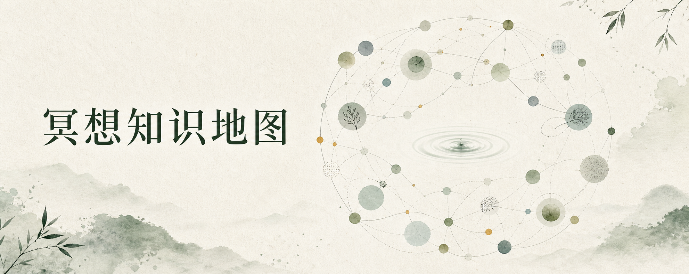

<p align="center">
  
</p>

<h1 align="center">冥想知识地图</h1>

<p align="center">从真实问题进入，连接概念、练习、过程、证据与安全边界。</p>

<p align="center">
  <a href="https://meditation-knowledge-atlas.vercel.app">在线交互地图</a> ·
  <a href="https://aiyouwendu.com/products">冥想产品</a> ·
  <a href="./paths/README.md">九问入口</a> ·
  <a href="./nodes/README.md">知识节点</a> ·
  <a href="./topics/README.md">专题长路线</a> ·
  <a href="./SOURCES.md">公开来源</a>
</p>

## 关于这张地图

“冥想”不是单一练习，“有效”也不能脱离人群、方法、指标和时间直接回答。当前 V3 公开版包含 **208 个有效节点、755 条关系、212 个精选公开来源**，并将阅读结构重新组织为：

- **9 个真实问题入口**：先回答读者实际会问的问题；
- **8 种知识职责**：区分概念、练习、机制、困难、回应、证据、安全与传统；
- **L1 / L2 两层节点**：49 个核心地标形成第一层地图，159 个深入节点按需展开；
- **4 条专题长路线**：为需要连续阅读的问题保留完整路径。

## 冥想产品

知识地图负责整理概念、实践、证据和安全边界；相关冥想产品集中展示在：

**[爱有温度｜冥想产品页面](https://aiyouwendu.com/products)**

## 从真实问题开始

| 问题入口 | 帮助你看见什么 |
|---|---|
| 冥想到底是什么，又不是什么？ | 从工作定义出发，分清冥想、正念、放松、呼吸练习与日常觉察。 |
| 不同冥想究竟在练什么？ | 沿注意方式、对象、动作和身体形式比较练习，不把不同维度混成单层分类。 |
| 注意、念头、身体和情绪发生了什么？ | 看见经验出现、注意被带走、发现偏离与重新选择之间的过程。 |
| 我该怎样开始，并选一个适合当下的练习？ | 把意图、形式、剂量、状态匹配、观察和退出条件编成可修改的小实验。 |
| 走神、困倦、烦躁或不舒服，意味着什么？ | 先判断应该返回、调整、停止还是寻求现实支持，而不是把困难统一解释为练错。 |
| 冥想怎样进入情绪和现实生活？ | 从识别与暂停走到策略、关系、问题解决和现实行动。 |
| 冥想可能有什么作用，证据能支持到哪里？ | 先限定练习、人群、时间和结果，再判断具体效果主张。 |
| 什么时候应该调整、停止或寻求帮助？ | 把一般困难、持续恶化、现实危险和专业支持边界分开。 |
| 冥想来自哪些传统和现代方案？ | 区分传统语境、世俗化、单项练习、多组件课程和练习伦理。 |

[查看九个入口及节点顺序 →](./paths/README.md)

## 八种节点职责

| 类型 | 节点数 | 作用 |
|---|---:|---|
| 基础概念 | 28 | 定义领域中的上位对象、状态与关键区别。 |
| 具体练习 | 27 | 练习者可以实际执行、调整或停止的动作。 |
| 过程与机制 | 46 | 解释注意、身体、念头和情绪怎样发生与变化。 |
| 练习条件与困难 | 23 | 说明练习如何受环境、剂量、状态和具体卡点影响。 |
| 现实回应 | 19 | 把觉察转成调节、沟通、问题解决与现实行动。 |
| 效果与证据 | 28 | 判断效果命题、研究设计、时间尺度与个体差异。 |
| 风险与边界 | 15 | 说明何时调整、停止、回到现实安全或寻求帮助。 |
| 传统与方案 | 22 | 保留实践的传统、课程、共同体与伦理语境。 |

[浏览全部 208 个节点 →](./nodes/README.md)

## 仓库结构

```text
paths/     9 个真实问题入口
topics/    4 条连续阅读长路线
nodes/     208 张公开知识卡片
data/      关系、来源与读者架构
assets/    GitHub 展示图片
SOURCES.md 精选公开来源索引
```

本仓库只包含已经进入公开范围的知识地图内容。第三方完整原文、个人观察、内部资料索引、批次记录、本地编辑后台、草稿与历史均不在这里。

## 证据与安全边界

- 研究证据、传统主张、作者解释和实践经验不会被当成同一种证据。
- 单篇研究、脑区变化、主观体验或名人故事不能单独证明普遍效果。
- 本项目不提供医疗诊断或个体化治疗建议，冥想不能替代医疗、心理治疗、睡眠、现实安全和必要行动。
- 如果练习持续加重惊恐、解离、创伤反应、自伤想法或现实功能下降，应停止自行推进并寻求合适的专业支持。
